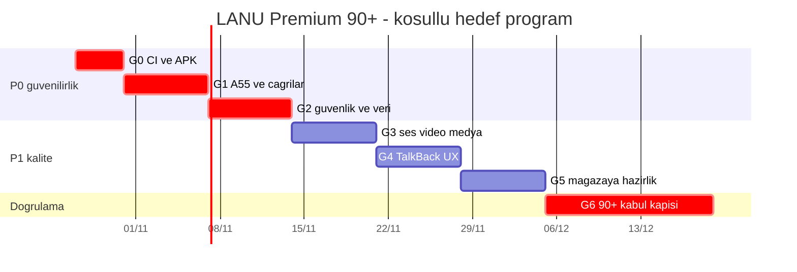

# LANU Hesap Makinesi — PREMIUM 90+ kalite ve uygulama programı

**Güncelleme:** 27.10.2026. Yalnız kanunal99-jpg/LANU-Hesap-Makinesi, paket com.aistudio.lanucalc.kxwzqm, Android min API23 / target API36.

## 0. Kanıt temeli

- 27 Ekim gözlem anında main f61e8dc2564d682f5c41ec4fe82dfb9e3347e3b8. OTA okuma koruması [PR #218](https://github.com/kanunal99-jpg/LANU-Hesap-Makinesi/pull/218) birleşmiş; PR baş SHA e3a19a3fe6234697032556cb65ade383eaf456d2 için [CI #642](https://github.com/kanunal99-jpg/LANU-Hesap-Makinesi/actions/runs/40530023409) başarılı.
- [Main CI #643](https://github.com/kanunal99-jpg/LANU-Hesap-Makinesi/actions/runs/40532440219) gözlem sırasında halen çalışıyordu. Son yayımlı [v1.1.0-signed.641](https://github.com/kanunal99-jpg/LANU-Hesap-Makinesi/releases/tag/v1.1.0-signed.641) commit d35c451efcb30e79eac63f04c677e252c52a4481 içerir; #218 içermez. Sonraki CI/release durumu ayrıca canlı kontrol edilmelidir.
- main protected:false olarak raporlandı. Ruleset, zorunlu PR check ve yazma denetimi P0 iş kalemidir.
- Bu puanlar eski uzman incelemesi + son OTA PR kanıtıyla güncellenen risk tahminleridir; tek tek fiziksel/bağımsız sertifika veya otomatik test skoru değildir. Eski yaklaşık 77 genel puan farklı değerlendirme yaklaşımından geliyordu. Bu belgede 18 alan eşit ağırlıklı, toplam **1368/18=76/100**; **11 alan 80 altındadır**.
- Kategori kanıt seviyesi raporları: kod, JUnit, Robolectric, Android emülatör, fiziksel cihaz ve bağımsız inceleme **ayrı** tutulur.

## 1. Puanlar ve 80+ için eksik kanıtlar

| Kategori | Bugün /100 | Kapı | Yapılacak / kanıt |
|---|---:|---|---|
| Hesaplama ve finans | 88 | P1 | #5, #193: taşan trigonometrik, sqrt/cbrt ve finans sınırları |
| Arayüz / UX | 82 | P1 | #84: OTA edge-to-edge, gerçek ekran, büyük font |
| Gizli alan / PIN | 83 | P0 | 2011. girişi ve opsiyonel PIN; kilit/dönüş ve kötüye kullanım |
| Metin mesajlaşma | 80 | P0 | Yanlış alıcı, yarış durumları, şifreli çevrimdışı kuyruk |
| E2EE / kimlik | 73 | P0 | #114: statik ECDH, downgrade ve replay; ratchet canlı değil |
| Medya | 70 | P1 | #85: 18 KB sınır, içerik/hash, quota, bozuk ek |
| Sesli arama | 75 | P0 | #3: iki fiziksel cihaz, çift yön RTP, BT ve ağ değişimi |
| Görüntülü arama | 73 | P0 | #3: kamera, izin, çift cihaz, yeniden bağlanma |
| Gürültü engelleme | 68 | P1 | WebRTC AEC/NS gerçek pipeline; ölçüm olmadan dB/ANC iddiası yok |
| Arka plan çağrı | 66 | P0 | #133: gerçek gelen FCM zil + görsel, kilit, OEM/DND |
| Room / yerel koruma | 68 | P0 | #113: SQLCipher canlı değil; kayıpsız gölge test + geri dönüş |
| Yedekleme / kurtarma | 82 | P0 | #83: cihaz dışı korunan imza yedeği ve gerçek restore |
| OTA | 89 | P0 | #218 CI #642 yeşil; main #643 ve cihaz yerinde güncelleme ayrı |
| CI/CD / APK | 94 | P0 | main ruleset kapalı, son HEAD CI ve public-release SHA/signer |
| Android uyumluluğu | 67 | P0 | #82: A55 ANR, API23/29/34/36 + ikinci OEM |
| Performans / tanılama | 75 | P1 | #82/#100: ANR/RAM/ağ, gizli içeriksiz tanılama |
| Erişilebilirlik | 74 | P1 | #191: TalkBack çağrı eylemleri, 48dp, 200% yazı |
| Mağaza / hukuki | 61 | P1 | #180/#192/#166: KVKK, FCM beyanı, public privacy URL |

**Hedef 1:** 18/18 en az 80, P0 açık olmamalı. **Hedef 2:** kritik alanlar ve genel puan 90+, mümkünse her kategori 90+, bağımsız kripto ve fiziksel test kanıtlarıyla. Puan, test sonucu negatifse düşebilir; saklanamaz.

## 2. Tarihli program — G0→G6

Bunlar **hedef çalışma pencereleri**, vaat edilen teslim tarihleri değildir. Önceki kapı kırmızıysa yenisi başlamaz. Eşzamanlı yalnız birbirinden izole kanıt toplama yapılabilir.

| Faz | Planlanan dönem | Yapılacak işler | Kapanış ölçütü | Sahip |
|---|---|---|---|---|
| G0 / Yayın bütünlüğü | 27–30 Ekim | #643 sonuç/log; varsa yeni signed.643 release; SHA-256, sertifika sürekliliği ve public bytes; 11 açık PR mükerrerlik taraması; branch protection | Main başarılı CI, tag/commit, imza, checksum ve herkese açık indirme aynı sürümde doğrulandı | Kod/CI; repo ruleset sahibi |
| G1 / Kritik cihaz ve veri | 31 Ekim–6 Kasım | #82 Samsung A55 çökme kök nedeni; #83 PKCS12 şifreli off-device gerçek kurtarma; #133 iki cihaz gelen arama ses+görsel kabulü | A55 yeniden üretim ve negatif regresyon; imza geri yüklemede sertifika eşleşmesi; 2 telefon kanıtı | Kod + fiziksel cihaz + owner |
| G2 / Mesaj güvenliği | 7–13 Kasım | Yanlış alıcı/race; çevrimdışı taslak/kuyruk; #113 sadece izole SQLCipher geçiş laboratuvarı; #114 statik ECDH/downgrade tehdit matrisi | Mesaj/kimlik/Room sıfırlanmadan test; **canlı SQLCipher/Double Ratchet kurulmaz** | Kod + bağımsız kripto inceleme |
| G3 / Çağrılar ve medya | 14–20 Kasım | #3 WebRTC ağ kopması, izin/BT, çift yönlü RTP; #85 medya boyut/hash/quota; AEC/NS tek pipeline | A55 + ikinci OEM üzerinde gerçek arama, mikrofon/video; ölçüm yoksa dB iddiası yok | Kod + gerçek cihaz |
| G4 / Kullanım kalitesi | 21–27 Kasım | #191 TalkBack, #84 OTA ekranı, #100 performans/ANR ve büyük yazı | 48dp, erişilebilir eylemler, 200% font, 2 gerçek cihaz performans/ekran kontrolü | Kod + gerçek cihaz |
| G5 / Yayın hazırlığı | 28 Kasım–4 Aralık | #180/#192/#166 KVKK/mahremiyet, FCM sadece çağrı izni, içerik/silme/ihracat, Play politikası | Public privacy URL, hukuki metin teyidi, gerçeğe uygun mağaza açıklaması | Kod + hesap sahibi + hukuk |
| G6 / Nihai kalite | 5–18 Aralık | 18 alanın yeniden puanlanması; bağımsız denetim; cihaz/OTA regresyonu; release testi | Her alan 80+ olmadan premium gate kapanmaz. 90+ yalnız somut kanıtla raporlanır | Tümü |

### Görsel zaman programı

## 3. Anayasal geliştirme ve yayın kapıları

1. **Önce hata:** başarısız CI job ve orijinal logu incele -> kök nedeni bul -> minimum değişiklik -> regresyon -> **son PR HEAD** üzerinde bütün gerekli testleri yeniden çalıştır. CI kırmızıyken yeni özellik PR birleştirme veya main release yasak.
2. **Mükerrerlik yok:** değişiklik öncesi güncel main blob/fonksiyonlarını, benzer açık PR'ları ve testleri karşılaştır. Bir soruna gereksiz tekrar PR açılmaz.
3. **Zorunlu kanıt:** JUnit, Robolectric, lint, API34 runtime, R8/minified APK, APK package/version ve signer/SHA; sunucu protokol/SQL testleri değişiklik alanına göre. PR push ile main push **ayrı** başarılı olmalı.
4. **Yayın:** Merge sonrası main run SHAsı, GitHub Release tag commit, APK checksum, eski stable sertifika ve public re-download byte-for-byte kontrolü. Sadece APK derlendi demek yayımlandı anlamına gelmez. CI başarısı iki fiziksel telefonda kabul anlamına gelmez.
5. **Gizlilik:** 2011. gizli girişi, isteğe bağlı PIN, E2EE kimliği, şifreli kuyruk, Room v4, imza ve kullanıcı verisi korunur. Destructive migration, zorunlu uygulama silme, yeni plaintext mesaj kayıtları, sessiz yeni Firebase/TURN maliyeti yasak.
6. **Gelişmiş koruma:** mevcut Room SQLCipher değildir; statik ECDH v1 ileri gizlilik vermez. Canlı migration/ratchet için bağımsız tasarım, test, geri dönüş, API23+ ve iki fiziksel cihaz kabulü gerekir; mevcut veriye varsayımsal geçiş yapma.
7. **Çağrı/ses:** FCM yalnız çağrı için opt-in; mesaj sistem bildirimi yok. Kullanıcının DND/sessiz/izin kararı aşılmaz. RNNoise, aktif AEC/NS, ANC/ENC, gürültü yüzdesi veya dB kazanımı cihaz sesiyle ölçülmeden reklam edilmez.
8. **Rapor:** her aşamada kategori: önce/sonra puan; PR/commit; PR CI; main CI; APK tag/hash/signature; gerçek cihaz kabulü; açık risk; insan onayı gereken adımlar. Kanıtsız puan artışı ve başarısız test saklama yasak.

## 4. Önce yapılacak kontrol

[CI #643](https://github.com/kanunal99-jpg/LANU-Hesap-Makinesi/actions/runs/40532440219) tamamlanınca en güncel yayın doğrulanacak. Ardından açık #198/#193/#192/#191/#186/#180/#166/#153/#138/#131/#1 yeni main ile karşılaştırılacak. Kullanıcıdan ek ödeme, servis, keystore veya cihaz testi için gerekli yetki/onay ayrı alınacaktır.

## 27.10.2026 — Ara kapı: 70 puanın altında kategori kalmayacak

**Kullanıcı kararı:** Önceki 80+ ve 90+ nihai hedefleri aynen korunur. Bunlardan önce, mevcut uzman değerlendirmesinde 70'in altında olan **dört kategori** için 70+ **kanıtlı ara kabul kapısı** getirilmiştir. Bu bir puan yükseltme talimatı değildir: gerçek test ve kaynak kod kanıtı olmadan 66/67/68 değerleri değiştirilmez. Önce kritik P0, sonra P1; başarısız test önce kök neden ve regresyon.

| Sıra | Kategori | Başlangıç | Minimum | Uygulanacak en yakın iş ve kabul kanıtı |
|---|---|---:|---:|---|
| 1 P0 | Arka plan çağrı | 66 | 70 | #133: FCM sadece çağrı, gelen sesli zil+görsel; kilit ekranı, normal süreç ölümü, sessiz/DND, PIN yeniden kilidi; Android unit/CI ve **iki gerçek cihaz** ayrı |
| 2 P0 | Android uyumluluğu | 67 | 70 | #82: A55 çökme/ANR çıkış nedeni; API23/29/34/36 matrisi, ikinci üretici; eski kurulum üstüne imzalı OTA veri koruması |
| 3 P0 | Room / yerel koruma | 68 | 70 | #113: gerçek Room plaintext sınırını gizleme; sentetik v4 SQLCipher shadow migration + WAL/disk dolması/rollback + schema parity; üretim migration **onaysız etkinleştirilmez** |
| 4 P1 | Gürültü engelleme | 68 | 70 | Gerçek WebRTC AEC/NS kullanımının yetenek/route testi; çifte işlemeyi engelleme, Bluetooth/kulaklık; ölçüm yoksa ANC/ENC/dB iyileşmesi iddiası yok |

**İş sırası:** 1→2→3→4. Her adımda mevcut kod/CI incelenir; gerekirse ayrı küçük PR, son PR HEAD'de test, merge sonrası yeni main CI ve imzalı APK. Fiziksel cihaz veya bağımsız güvenlik onayı eksikse durum **kısmi/doğrulanmadı** olarak kalır. Başarı: 18 kategorinin **tamamı ≥70**; ardından 18/18 ≥80 ve kanıtlı 90+ programı. Kullanıcının Room/PIN/2011./E2EE/OTA imzası ve verileri silinmez. Ücretli servis izinsiz açılmaz.
