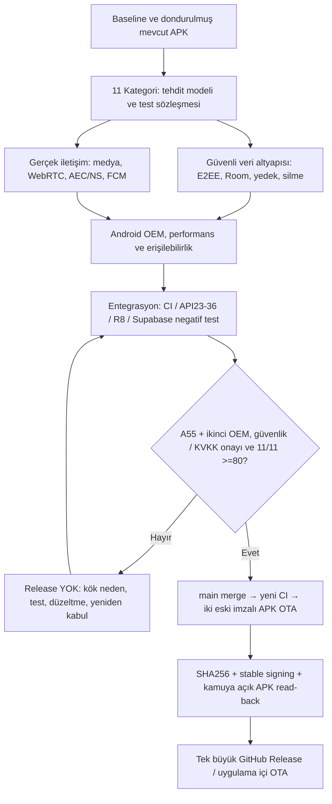

# LANU Hesap Makinesi — TEK BÜYÜK QUALITY80 GELİŞTİRME ve YAYIN PLANI
**Plan tarihi:** 11 Kasım 2026 • **Hedef:** 11/11 düşük kategorinin her biri en az **80/100**, güvenli imzalı tek büyük sürüm • **Statü:** PLANLANMIŞ; kalite ve saha kabulü henüz tamamlanmadı.

> **Talimat:** Önce plan, sonra geliştirme+entegre test, **en son** GitHub Releases APK. Birim testte başarılı birkaç küçük PR, metinde 80 yazmak veya yalnız CI yeşil olması 80 kanıtı değildir. Son doğrulanmış kullanıcı APK'sı **v1.2.0-signed.1284**; bunun mevcut veri, PIN, mesajlar, E2EE kimliği ve imza sürekliliği korunur. Bu büyük sürümün tamamı doğrulanmadan ona ait APK yayınlanmaz.

## 1. İstenen sonuç ve sınırlar
- **Tek koordineli program / tek kullanıcıya dönük büyük sürüm:** 11 alt sistemi tek sürüm dalında, her birinin test/rollback bağıyla yönet. Bağımsız doğrulama commitleri ve kod sahipliği mümkündür; **tek bir özellik başarıya ulaştı diye kullanıcıya kısmi büyük sürüm çıkarma**.
- **11 kategori birlikte geçecek; sıfır açık kritik P0**; 80 altındaki kategori otomatik yükseltilmez. Her kategorinin puanı *mevcut kod+test+saha/bağımsız kabul kanıtı* ile tekrar verilir. 80+ için hard gate de gereklidir.
- Güç kaynağı/sürüm/şifreleme/servis sürekliliği: `2011.`, isteğe bağlı PIN, mevcut Room v4 mesaj/kimlik/rehber/konuşma/geçmiş, mevcut OTP/FCM opt-in, paket adı, signing fingerprint ve veri kayıpsız OTA. **Destructive migration, kurulu APK'yi kaldırma, silent key rotation, plain media upload, varsayılan açık tehlikeli feature flag ve ücretli servis yok**.
- **Dış kaynak zorunluluğu:** A55 + farklı marka ikinci telefon, hukuki KVKK veri sorumlusu onayı, kullanıcı kontrollü şifreli imza yedeği, bağımsız kripto/anahtar kurtarma kabulü bazı katmanların 80 olması için şarttır; CI simülasyonu bunların yerine geçmez.
- Dağıtım yalnız GitHub Releases ve imza sabit uygulama-içi OTA. **Google Play yayını yok.** Kullanıcı izni olmadan canlı hesaba, mesajlara, sunucu verisine veya ödeme bilgisine dokunulmaz.

## 2. Başlangıç kategorileri ve büyük sürümün 11 teslim paketi

| ID | Kategori | Son kanıtlı puan | Hedef | BÜYÜK geliştirme, ana bileşenler | Zorunlu bağımsız kabul |
|---|---|---:|---:|---|---|
| Q80-01 | E2EE / kimlik | 73 | >=80 | Mevcut ECDH v1 ile koeksiste çalışan kimlik doğrulamalı, sürümlü ratchet; oturum yenileme, rollback/güvenli yedek, kuyruk sırası, iki taraf onayı, downgrade/replay reddi; PR #357'deki native/Android/sunucu tamamlanmadan üretimde ETKİN DEĞİL | Bağımsız kripto denetimi, iki cihaz, kayıp/yeniden kurulum/restore |
| Q80-02 | Güvenli fotoğraf / belge / medya | 70 | >=80 | 40 MiB üst sınırla doğrulanmış private ciphertext upload+download; doğrulanmış peer/signed grant, hash/TTL/quota/replay, TUS resume, cihazdan çift yönlü SAF/Photo Picker ve şifreli önbellek; PR #331 tamamlanmadan server flag KAPALI | İki gerçek cihazda gönder/al, kötü dosya, kota, ağ kopması, sınırlı depolama; ücrete onay verilmedikçe yükseltme yok |
| Q80-03 | Sesli arama | 75 | >=80 | WebRTC gerçek çift yön RTP doğrulama; medya/ICE epoch, SIM/WhatsApp bekletme (HOLD/RESUME), FGS ömür/yeni arama, TURN/STUN geri dönüş, BT route pending ve Android 12+ asenkron aygıt teyidi | Samsung A55 + ikinci OEM: en az 20 karşılıklı çağrı, SIM/WhatsApp, BT, WIFI/LTE, kopma, anında yeniden arama |
| Q80-04 | Görüntülü arama | 73 | >=80 | Camera2→Camera1→capture profiles, kamera flip/izin, gecikmiş callback, RTP gerçekliği, ses-öncelikli adaptif bitrate ve geri çıkış, video bozulsa sesin kalması, ağ/oem fallback | İki telefon: ön/arka, kamera izni/arka plan, 2G/4G/Wi-Fi simüle bozulma, ısınma ve pil |
| Q80-05 | AEC/NS/AGC / konuşma anlaşılabilirliği | 68 | >=80 | Tek WebRTC AudioDeviceModule zinciri; OEM hardware AEC/NS vs software APM fallback, highpass/mono/Opus FEC, route/mute/focus, çift işleme yasak, GPU/AI istemeden kontrollü gerçek ölçüm; neural RNNoise ancak ölçümle kanıtlanırsa ayrı kapı | Fan/trafik/rüzgâr/hoparlör çift konuşma, Bluetooth/speaker ölçümü; dB, anlaşılabilirlik, P50/P95, boğukluk ve ek latency |
| Q80-06 | Arka plan FCM / gelen çağrı | 66 | >=80 | Yalnız ayrı opt-in ile gizli çağrı/mesaj ipucu; foreground/background/dead process, kilit/DND/Doze, stale/alakasız FCM filtre, gerçek çağrı TTL/timeout, tekrar bildirimi; gizli içerik/log yok | İki cihazda 20+ ekran kilidi/Doze/sessiz/bildirim izni/uygulama kapalı senaryosu; teslim ve false-alarm oranı |
| Q80-07 | Room / yerel veri koruma | 68 | >=80 | 7 tablo için bağımsız doğrulanabilir SQLCipher **gölge DB**; Keystore key ve non-destructive atomik cutover; WAL/SHM/checkpoint, düşük disk, süreç ölümü, bozuk DB için eski veriye dokunmadan rollback; onay gelene dek canlı geçiş KAPALI | Gerçek eski verili iki cihaz, yüksek hacim, yedek round-trip, downgrade/yarım geçiş; 0 kayıt kaybı, imza/kimlik/PIN korunması |
| Q80-08 | Android API / OEM | 67 | >=80 | API23,29,31,34,36 uyum matrisi; A55 ANR/native crash kökü, BT/HFP/BLE asenkron route teyidi, mikrofon/kamera izinleri, FGS/Doze, 16KiB native, Huawei GMS yokken güvenli degrade, Xiaomi pil tasarrufu | Samsung A55 + Xiaomi/Huawei ikinci OEM, 48dp/tüm rotalar/uygulama kilidi, tekrarlı ve hata testleri |
| Q80-09 | Performans / tanılama | 75 | >=80 | Kullanıcının açtığı ekran başlatma, mesaj RTT ve ağ geri dönüşü, çağrı P50/P95 (yalnız gizlilik güvenli aggregate), ANR/heap/ısınma; request budget, backpressure, cancellation, güvenli log; test senaryosu ile ölçüm | A55 + ikinci cihaz 30+ dakika loop, düşük RAM, sıcaklık, kesik ağ, kullanıcı onaylı yalnız anonim telemetry; belirlenmiş P95 sınırları |
| Q80-10 | Erişilebilirlik / Compose | 74 | >=80 | TalkBack semantiği, 48dp touch targets, 200% font, renk kontrastı, klavye focus, medya/çağrı görsel/sözel state, güvenli gizli ekranın erişilebilirliği ve ekran yönü | TalkBack açık iki cihazda tüm esas akışlar, büyük yazı, ekran okuyucu ve düşük görme kontrast kontrolü |
| Q80-11 | KVKK / hesap ve sunucu verisi silme | 61 | >=80 | Sahibi imzalı/teyitli hesap silme, izole ve atomik sadece kendi account/ciphertext/FCM/metadata temizliği, private Storage fiziksel temizlik, sınırlandırılmış saklama, idempotent veri silme makbuzu; PR #266 staging/tehdit modeli; gerçek HTTPS başvuru ve şeffaf politika | Gerçek kamuya açık KVKK başvuru yolu ve sorumlu kişi onayı; insan/hukuk teyidi; RLS, cross-account, rollback testi; canlı hesap testinde gerçek veri silme YOK |

Bu tabloda hedef **11/11 >=80**'dir, üstü performans için ek kazanımdır. Kod düzeyinde eksik kalan bir paket bile diğer 10'un başarılı oluşuyla tamam sayılmaz.

## 3. Tek büyük sürüm mimarisi / bağımlılıkları

**Bileşen sınırları:** `core/messaging` E2EE ve ratchet; `core/database` Room + shadow SQLCipher; `core/media` ciphertext-only; `core/calls` WebRTC/Opus/FCM/route; `core/location` mevcut consent; `core/diagnostics` privacy-safe ölçümler; `features/security/communication/update` Compose ekranları; `supabase/functions/lanu-relay` + PostgreSQL RLS önleyici protokol. Tek doğrulanmış owner per identity/call/transaction/OTA.

**Her kritik zincir:** Ana servis → alternatif → gerçek fallback → başarısızlık/kesinti/kısmi işlem handler → fail-closed güvenli varsayılan → içerik/kimlik sızdırmayan monitoring → gerçek smoke ve olumsuz test. Yetkisiz erişim, şifre bozulması, imza uyuşmazlığı, alıcı yanlış eşleşmesi, relay TLS hatası, taşıma kesintisi ve OEM sürücü kusuru için kesin dönüş.

## 4. Tek program içinde altı zorunlu uygulama kapısı

### G0 — Mimari, sürüm ve kanıt tabanı (ilk)
- `main` SHA, güncel yayın SHA/sertifika, tüm açık P0/P1 ve bağımlılık ağacı kayıt altına alınır. Bu belge anayasaya bağlanır.
- Açık #357 (Ratchet), #331 (medya), #266 (sunucu silme) ayrı üretim etkinliği olarak kabul edilmez: branch conflict/test/flag/gerçek sunucu ihtiyacı gözden geçirilir.
- 11 kategori için kod-test-saha delil dosyası oluşturulur; hazır olmayan `unverified` olarak görünür. Puan hedefleri **kanıt sayılmaz**.
- “Tek büyük kullanıcı sürümü” dalı altında gerçek kod entegre edilir; ara commitler olabilir, kısmi APK dağıtımı yok.

### G1 — Gizlilik, kimlik, veri ve güvenli yedek (Q80-01/07/11)
- v1 E2EE köprüsü, ratchet ve peer proof'un downgrade/replay tehdit modeli; kullanıcı onaysız anahtar/gönderim sıfırlama kesinlikle yok.
- SQLCipher için key vault, gölge tablo / WAL geri dönüş, bozuk disk ve eşzamanlı ölüm acceptance; eski plaintext DB silinmez. İsteğe bağlı PIN sürekli çalışır.
- Hesap silmede sunucu identity, FCM, mesaj/sinyal ve özel Storage objesi kapsamı net; sahte imza, geçersiz izin, başka kişi, retry/timeout ve kısmi 0-row sessiz başarı asla olmaz.
- İmza anahtarının cihaz dışı **kullanıcı kontrollü şifreli yedeği** ve bağımsız restorasyonu; private key asla chat/repo/artifact'a aktarılmaz.

### G2 — Gerçek medya / ses-video / FCM / OEM (Q80-02/03/04/05/06/08)
- İki gerçek cihazın karşılıklı medya/ses-video/FCM kabul matrisi. Aynı oturumda 90+ saniye harici arama bekletme, yeniden ses odağı ve anında ikinci çağrı. Yeniden bağlantıda önceki RTP sayaçları “bağlı” gösteremez.
- AEC/NS çift zincir olmadan ölçülür; boğukluk/yankı varlığında üretici uyumlu software fallback kullanılır. DTX=1 zorlaması ve yeni ücretli DSP yok.
- Gürültülü ortamda referans konuşmanın anlaşılabilirliği ile paket kaybı ve gecikme ayrı izlenir; mikrofon içeriği uzaktaki servise veya üretim günlüğüne kaydedilmez.
- 40MiB medya/özel konum/protocol API altında byte-count, checksum ve consent; sunucuda gerçek açık medya veya serbest key yok.

### G3 — Performans, dayanıklılık, Compose/a11y (Q80-09/10)
- Uygulama başlatma/PIN/sohbet/çağrı ekranı, 20k kayıt, 30dk arka plan ve düşük RAM durumunda memory/ANR/işlem bütçeleri; iptal sonrası leak yok.
- 200% yazı, 48dp, TalkBack ve odak sırası: hesap makinesi, gizli PIN, sohbet, mesaj, çağrı, kamera, konum, OTA, yedekleme, silme onayı dahil eksiksiz kullanım.
- Gereken tek hata telemetry'si sınırlandırılmış ve güvenli kategori sayaçlarıdır; kullanıcı kodları, IP, anahtar, konuşma, ham PCM, FCM token'ı loglanmaz.

### G4 — Birleşik CI, güvenlik ve saha kabulü (11/11)
- Birim/negatif/iptal/replay testleri, Android Robolectric, API23/29/31/34/36, Android 14 gerçek Room runtime, ağ/TURN/FCM/BT mümkün olan emülatör katmanları, Node/PGlite/RLS, R8, 16KiB ELF.
- İki gerçek cihaz: A55 + en az ikinci marka (tercihen Xiaomi ve Huawei için ayrıca bir cihaz). Ekran kapalı/Doze, SIM+WhatsApp, 2 yol RTP, BT/BLE/HFP, Wi-Fi/LTE, gürültü/yankı, uzun görüşme, OTA; sonuç video/logu kişisel veri sızdırmadan sahibinin onayıyla delillenir.
- İleri gizlilik, depolama migration, sunucu veri silme; bağımsız gözden geçirme ve gerçek yedek geri yükleme ile kabul edilir; "testte mock success" kabul edilmez.
- Ölçüm önerilen başlangıç SLO'ları: kontrollü Wi-Fi/4G konuşmada çağrı kurulumu P95 <= 10s, kullanıcı etkileşimi P95 <= 250ms, bağlantı dönüşünde yanlış CONNECTED 0, hesap/kimlik/veri kaybı 0, private içerik log sızıntısı 0; gürültü/STOI/PESQ/ERLE/ek DSP latency hedefi **önce aynı cihaz referans ölçümü** ile kalibre edilip bağımsız değerlendirilir. SLO başarısızsa puan arttırılmaz.

### G5 — **Tek** üretim APK yayını; yalnız G4 başarılıysa
- Birleşik büyük sürümün son SHA'sında PR CI yeşil, bağımsız güvenlik/cihaz/kuruluma ilişkin kritik kabul dosyaları tamam, **11/11 kategori puanı >=80**, açık P0=0.
- Squash merge `main`, **yeni** trusted main CI, signing continuity, Android 14 emülatöründe iki farklı önceki **imzalı APK** üzerinden `adb install -r` ile 7 tablo, kimlik, PIN, mesaj/geçmiş, kuyruk tutarlılığı testleri.
- GitHub Releases'te kullanıcı tarafından doğrudan indirilebilen `app-debug.apk` (ad eski OTA uyumu; üretim imzalı/R8), `.sha256`, `.signer.txt`; eski `v1.1.0-signed` OTA köprüsü; anonim HTTPS geri indirme, byte-for-byte hash ve sertifika doğrulama.
- Kullanıcıya **sürüm/commit/CI/APA SHA/signer/cihaz kabul puanları ve kalan riskler** belgelenerek bildir. APK fiziksel kullanıcı cihazlarına sessiz kuruldu denmez.
- Herhangi bir hard gate başarısızsa yalnız güvenli son sürüm kalır: `v1.2.0-signed.1284`, başarısızlığı görünür kıl; puan/Release uydurma.

## 5. Tek seferde 80+ ilan etmeyi engelleyen kanıt kapısı

Her Q80-NN kabul kaydı için alanlar: `baselineScore`, `targetScore=80`, `measuredScore` (kanıt yoksa null), `sourceAndCi`, `negativeTests`, `deviceAcceptances`, `independentReviews`, `noDataLoss`, `criticalBlockers`. Geçme koşulu:
1. `measuredScore >=80` ve bağlayıcı test/ölçüm/delil dosyası var;
2. `criticalBlockers=0`, sahte/sentetik cihaz kanıtı yok, bağımsız onay gereken dosyalarda owner kaydı var;
3. Tam **11/11** pass, sonra yayın işi. Başlangıçta `measuredScore=null`; bu başarısızlık değil, **henüz doğrulanmadı** anlamındadır. `targetScore` asla `measuredScore` olarak kopyalanmaz.

## 6. Bilinen açık blockerlar, riski saklamadan

| Risk / issue | Neden önemli | Kapanış delili |
|---|---|---|
| #113: Room SQLCipher | Standart Room DB'nin disk üzerinde tamamının şifrelenmesi henüz üretimde yok | Kayıpsız, rollback'li gerçek migration/restore, iki cihaz ve disk/WAL testleri |
| #114 / PR #357: Ratchet | v1 statik ECDH ileri gizlilik vermez; büyük PR henüz `main` değil | Protokol tasarım+bağımsız kripto inceleme, native ABI, peer state, restore/replay testleri |
| #224 / PR #266: Tam hesap silme | Yerel silme sunucu metadata/FCM/object temizlik kanıtı değil | Hukuk/onay, public URL, RLS + idempotent database+object silme |
| #133: FCM | Emülatör başarılı olsa bile iki telefonda kilitli ekran/zil garanti değil | A55 + ikinci OEM cihaz kaydı ve push gerçek teslim testi |
| #245: Android 12+ route | `setCommunicationDevice` anlık kabulü yönlendirme kesinliği değildir | Asenkron teyit + BLE/HFP gerçek routing |
| #83: signer kurtarma | Cihaz kaybında gelecekte OTA kilitlenebilir | Cihaz dışı şifreli yedek ve güvenli restore challenge |
| #3: iki cihaz çağrı | Gerçek çift yön RTP, video, OEM uyumu CI'la tam ispatlanmaz | Farklı cihazlarda kaydedilmiş izinli çağrı ve arıza matrisi |
| #100: ANR/Crash | CI iyi olsa bile A55 ANR/native sürücü riski | OEM olay sınıflandırması ve crash-free saha koşusu |
| #331: private medya | Staged signed storage tam canlı aktarım sayılmaz | E2EE uçtan uca iki cihaz, quota ve maliyet kontrolü |

## 7. Durum raporu sözleşmesi (ürün sahibine)
Her raporda tek tablo: **11 kategori / başlangıç / uygulanan kod / PR HEAD test / cihaz-kabul / bağımsız denetim / gerçekleşen puan** ve tek sonuç: *planlandı*, *geliştirme branch'inde*, *CI geçti*, *cihaz kabulü eksik*, *main'e birleştirildi*, *APK public URL ve sertifika doğrulandı*. Bunlardan hiçbirini birbirinin yerine kullanma.

**Karar:** Bu belge tek büyük sürümün planıdır. G0 kabulü yayın yetkisi değildir; son kullanıcıya nihai QUALITY80 APK'sı yalnız G5 gerçekten geçildikten sonra yayımlanacaktır.
